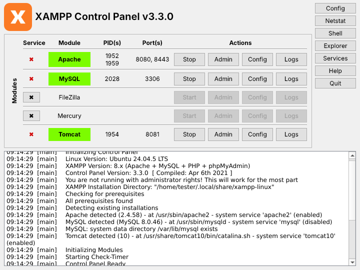

# XAMPP-style Control Panel for Linux

Panel de control de escritorio para **Apache + PHP + MySQL + phpMyAdmin** (y Tomcat) en Linux, inspirado en el
XAMPP Control Panel de Windows. Funciona en distribuciones con paquetes `.deb` (Ubuntu, Debian, Linux Mint, Pop!_OS…).

> Proyecto no oficial: no está afiliado a Apache Friends ni a XAMPP.



## Instalación

1. Descarga el `.deb` de la última versión en [Releases](../../releases/latest).
2. Instálalo:

```bash
echo "phpmyadmin phpmyadmin/dbconfig-install boolean false" | sudo debconf-set-selections
sudo apt install ./xampp-linux_*_all.deb
```

3. Ábrelo desde el menú («XAMPP Control Panel») o con `xampp-control-panel`.

Tus proyectos van en `~/.local/share/xampp-linux/htdocs` → <http://localhost:8080/>

## Qué hace

- Start/Stop, Admin, Config y Logs por módulo, con PIDs, puertos y log en tiempo real.
- Apache con PHP y HTTPS (`https://localhost:8443`), MySQL (root sin contraseña), phpMyAdmin y Tomcat opcional.
- Detecta lo que ya tienes instalado y resuelve puertos ocupados (usar otro puerto o parar el servicio).
- Instala módulos como servicios de usuario de systemd (columna *Service*).
- Explica los fallos (últimas líneas del log + pistas) en vez de un genérico «shutdown unexpectedly».
- Todo corre con tu usuario, sin root. MySQL y phpMyAdmin solo escuchan en local.
- En distribuciones sin MySQL (Debian) usa MariaDB automáticamente.

## Requisitos

`python3` ≥ 3.9 y `python3-pyqt6` (el resto de dependencias las instala `apt`). Probado en Ubuntu 24.04.

## Desarrollo

```bash
./build-deb.sh          # genera dist/xampp-linux_<versión>_all.deb
python3 src/xampp_linux.py   # ejecutar sin instalar (necesita Apache, MySQL y phpMyAdmin instalados)
```

### Publicar una versión

```bash
git tag v3.3.1
git push origin v3.3.1
```

GitHub Actions construye el `.deb` y lo adjunta a una *Release* automáticamente.

## Licencia

MIT. Ver [LICENSE](LICENSE).
